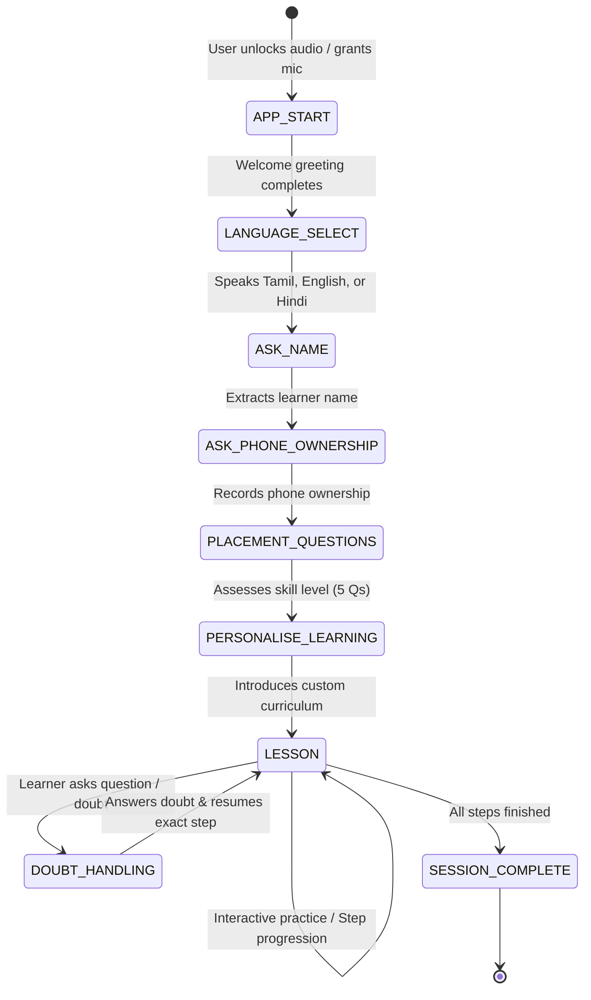

# FirstTap — Voice-First Digital Literacy Learning Companion

**FirstTap** is an accessible, voice-first digital literacy companion specifically built for beginners in India. It empowers learners to master smartphones, popular mobile apps, internet navigation, UPI digital payments, and cyber fraud defense without needing to read complex text or navigate confusing menus.

A friendly, animated cartoon character (**Tapu**) acts as the learner's personal mentor—greeting them, asking gentle questions, listening to spoken answers, speaking in native Indian languages, and delivering hands-on micro-lessons.

---

## 🌟 Key Features

1. **Voice-First Experience**:
   - The entire onboarding, placement assessment, and lessons can be traversed strictly through speech.
   - Built around the lifecycle: `IDLE` → `SPEAKING` → `LISTENING` → `TRANSCRIBING` → `UNDERSTANDING` → `RESPONDING`.
   - Single-turn recording with silence endpointing (VAD) prevents infinite recording loops and audio playback overlaps.

2. **Multilingual Architecture**:
   - **Tamil (`ta-IN`)**: Primary initial language with culturally natural phrasing.
   - **English (`en-IN`)**: Indian English accent adaptation.
   - **Hindi (`hi-IN`)**: Clear, conversational Hindi instructions.
   - Architecture is decoupled to easily plug in Telugu, Kannada, Marathi, Bengali, and other Indian languages.

3. **Deterministic FSM (Finite State Machine)**:
   - State-driven conversation flow prevents conversational drift.
   - States: `APP_START`, `LANGUAGE_SELECT`, `ASK_NAME`, `ASK_PHONE_OWNERSHIP`, `PLACEMENT_QUESTIONS`, `PERSONALISE_LEARNING`, `LESSON`, `DOUBT_HANDLING`, `RETRY`, `SESSION_COMPLETE`.
   - Handles interruptions and seamlessly resumes the exact lesson step.

4. **Animated Cartoon Character (Tapu)**:
   - SVG + Framer Motion animated tutor.
   - Dynamic states: Waving, Blinking, Speaking (mouth movement synced to audio amplitude), Listening (glowing aura + perked headphones), Thinking, Celebrating (confetti animation).

5. **Cybersecurity & UPI Safety Curriculum**:
   - Simulated interactive smartphone screen on-device.
   - Practical lessons on QR code scanning, verifying shop names before paying, and the Golden Rule: **Never enter PIN or share OTP to receive money**.

6. **Hybrid Cloud AI & Zero-Crash Fallback**:
   - **Sarvam AI Saaras (STT)** & **Sarvam AI Bulbul (TTS)** integration.
   - Graceful fallback to Browser Web Speech API and SpeechSynthesis when API credentials are not provided—ensuring the application is 100% functional and testable out of the box!
   - Guardrailed LLM doubt resolution with strict cybersecurity system prompt.

---

## 🛠️ Technology Stack

- **Framework**: Next.js 16 (App Router, Turbopack)
- **Language**: TypeScript
- **Styling**: Tailwind CSS v4
- **Animations**: Framer Motion & Canvas Confetti
- **Audio & Speech**:
  - Browser MediaRecorder & Web Audio API (AudioContext analyser)
  - Sarvam AI Speech-to-Text API (`saaras:v1`)
  - Sarvam AI Text-to-Speech API (`bulbul:v1`)
  - Browser `window.speechSynthesis` & `webkitSpeechRecognition` fallback
- **State Management**: Pure TypeScript Typed Finite State Machine (FSM)
- **Unit Testing**: Node test runner with `tsx`

---

## 📋 Conversation Flow & States



---

## 🚀 Getting Started

### 1. Prerequisites
- Node.js 18+ (tested on Node v24)
- npm 9+

### 2. Installation
```bash
git clone <repo_url>
cd firsttap
npm install
```

### 3. Environment Variables
Copy `.env.example` to `.env.local`:
```bash
cp .env.example .env.local
```

Fill in your API credentials (optional):
```env
# Sarvam AI API Key for real Indian-language STT and TTS
SARVAM_API_KEY=your_sarvam_api_key_here

# Google Gemini API Key for spontaneous digital literacy doubts
GEMINI_API_KEY=your_gemini_api_key_here

NEXT_PUBLIC_APP_NAME=FirstTap
```

> **Note on Demo Mode**: If `SARVAM_API_KEY` or `GEMINI_API_KEY` are not set, FirstTap automatically activates **Demo Mode**. Spoken audio will play through your browser's native text-to-speech engine and verified cybersecurity answers will be used, allowing complete evaluation without API charges.

### 4. Running the App
```bash
npm run dev
```
Open [http://localhost:3000](http://localhost:3000) in your browser (Chrome or Edge recommended for full microphone & Web Speech support).

### 5. Running Automated Unit Tests
```bash
npx -y tsx src/lib/fsm/__tests__/fsm.test.ts
```

All 5 core state transition test suites will run and validate:
- Language intent matching across Tamil, English, and Hindi
- Natural name extraction from conversational phrases
- Spoken affirmative and negative intent matching
- Complete placement progression and literacy level scoring
- Doubt handling interruption and step resumption

---

## 📁 Project Architecture

```
firsttap/
├── src/
│   ├── app/
│   │   ├── api/
│   │   │   ├── llm-doubt/route.ts   # Guardrailed LLM doubt resolution
│   │   │   ├── stt/route.ts         # Sarvam Saaras STT & fallback
│   │   │   └── tts/route.ts         # Sarvam Bulbul TTS & fallback
│   │   ├── globals.css              # Tailwind CSS styles
│   │   ├── layout.tsx               # Root layout & Outfit font
│   │   └── page.tsx                 # Main FirstTap voice interface
│   ├── components/
│   │   ├── Captions.tsx             # Accessible live subtitles
│   │   ├── ControlBar.tsx           # Voice dock & accessible buttons
│   │   ├── Header.tsx               # Language switcher & status badge
│   │   ├── LessonInteractive.tsx    # Mobile phone simulator & safety challenges
│   │   ├── Mascot.tsx               # Animated SVG mascot (Tapu)
│   │   ├── PermissionModal.tsx      # Welcome & mic permission unlock
│   │   └── VoiceVisualizer.tsx      # Reactive audio waveform
│   ├── lib/
│   │   ├── fsm/
│   │   │   ├── __tests__/fsm.test.ts # FSM test suite
│   │   │   ├── intents.ts           # Speech intent recognition
│   │   │   └── machine.ts           # Typed Finite State Machine
│   │   ├── lessons/
│   │   │   └── catalog.ts           # Curriculum, prompts & questions
│   │   └── voice/
│   │       └── engine.ts            # Voice engine with VAD & MediaRecorder
│   └── types/
│       ├── declarations.d.ts        # Module declarations
│       └── index.ts                 # TypeScript type definitions
├── .env.example                     # Example environment variables
├── package.json
└── tsconfig.json
```

---

## 🔒 Security & Privacy

- **Never logs raw audio**: Voice recordings are processed in memory and never stored without consent.
- **Strict Financial Guardrails**: The LLM system prompt forbids asking for passwords, OTPs, PINs, bank account numbers, or debit card CVVs.
- **Safe Fallback**: If network or external APIs fail, the local deterministic FSM and browser synthesis keep the learner safe without application crashes.
